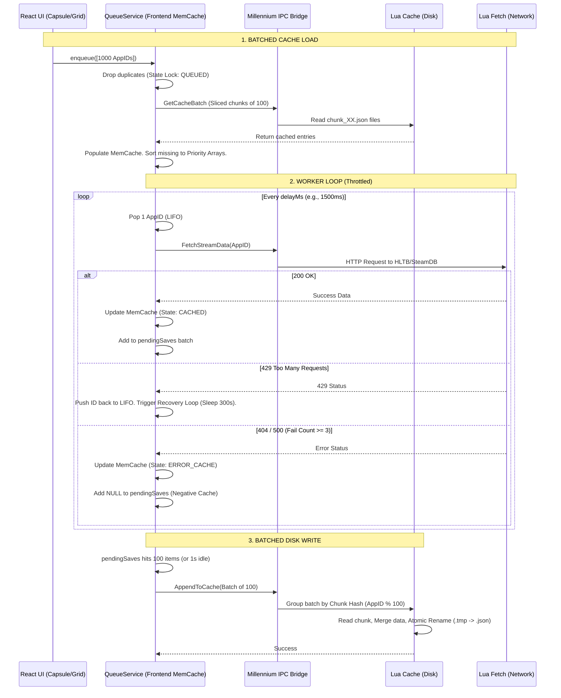

# Sortium Architecture: Two-Tier Cache & Queue Pipeline

This document explains the architecture driving Sortium's data fetching, queuing, and caching layers. It is designed as a learning resource for managing massive datasets within the Steam Millennium framework.

## The Millennium Challenge
Millennium bridges a React frontend with a Lua backend via Inter-Process Communication (IPC). This creates unique bottlenecks:
1. **IPC Payload Choke:** Sending massive JSON strings (e.g., 5,000 games) across the IPC bridge crashes the client. 
2. **File Lock Races:** Lua lacks robust asynchronous file locking. Concurrent writes corrupt JSON caches.
3. **UI Thread Blocking:** Rapid React re-renders or unoptimized while-loops lock up the Steam client UI.

## Full System Diagram

## 1. Two-Tier Cache System

Sortium uses a split caching model to ensure instant UI rendering while protecting disk longevity.

### Tier 1: Frontend Memory Cache (`queue.ts`)
A strict state machine (`MISSING`, `QUEUED`, `BATCHING`, `FETCHING`, `CACHED`, `ERROR_CACHE`).
* **Instant Resolution:** UI components read synchronously from this memory dictionary.
* **Negative Caching:** Persistent API failures (404s) are stored as `ERROR_CACHE` with a 24-hour expiration. This stops the queue from indefinitely hammering broken endpoints.
* **State Locks:** Prevents "React Spam." If a user rapidly scrolls or toggles filters, the `QUEUED` state instantly drops duplicate fetch requests.

### Tier 2: Backend Disk Cache (`cache.lua`)
A hashed, chunked JSON storage system.
* **Chunk Hashing:** Instead of one massive 10MB JSON file, AppIDs are hashed (`AppID % 100`). Data is split across `chunk_00.json` to `chunk_99.json`.
* **Atomic Writes:** Lua writes to `chunk_XX.json.tmp`, then executes an OS rename. This prevents data corruption if Steam closes mid-write.
* **Paginated IPC:** The frontend never asks Lua to save or load more than 100 games at a time. This keeps the IPC pipe clean and prevents memory crashes.

## 2. Queue & Worker Pipeline

The worker loop manages external API limits without breaking the UX.

* **LIFO/FIFO Split:** 
  * *Missing data* goes into a High Priority LIFO array (Last-In, First-Out). As the user scrolls down their library, the *newest* visible games are fetched immediately.
  * *Soft-expired data* goes into a Low Priority FIFO array (First-In, First-Out). These update silently in the background.
* **Dynamic Throttling:** Streams define their own `delay` (e.g., HLTB uses 1500ms).
* **Deadlock Recovery:** If an API returns a `429 Rate Limit`, the worker halts, pushes the AppID back to the front of the queue, sleeps for 5 minutes, and tests a single ID before resuming.
* **Zombie Killers:** Every `await` checks `if (this.isDismounted) break;`. If the user closes the UI tab during a 5-minute rate limit sleep, the worker safely dies instead of mutating dead React states.
