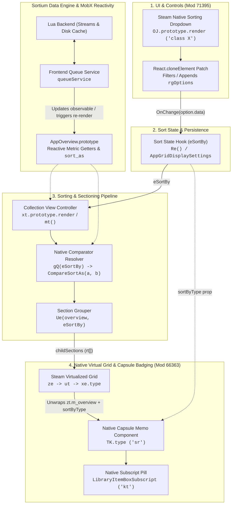
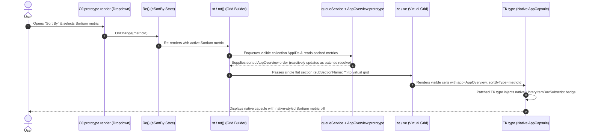

# Sortium Native Architecture (Empirically Verified)

This document outlines the reverse-engineered native Steam client architecture for **Sortium**, verified directly against the running Steam client runtime via the Chrome DevTools Protocol (`http://localhost:8080/json`).

> [!IMPORTANT]
> **Dynamic Module Resolution**: Numeric Webpack module IDs (`71395`, `11726`, `66363`, `50777`) and 2-letter minified export keys (`OJ`, `gQ`, `TK`, `ZU`) are build-specific artifacts shown here for reference. Production code **must** resolve modules dynamically via `@steambrew/client` (`findModuleByExport`, `findClassModule`) using stable signatures (such as localization tokens like `"#Library_SortCollectionBy"` or CSS class keys like `SortingDropDown` and `LibraryItemBoxSubscript`).

---

## 1. High-Level Native Architecture



---

## 2. Sequence of a Sort Operation



---

## 3. Webpack 5 & MobX Runtime Constraints

Before patching any Steam module, three runtime invariants must be respected:

1. **Webpack 5 ES Module Export Getters are Non-Configurable**:
   Webpack defines module exports via `t.d(exports, { key: () => fn })`, which sets `{ get: [Function], set: undefined, configurable: false }`. Plain exported functions (`gQ`, `IJ`, `xZ`) **cannot** be overwritten on the module export object (`afterPatch(mod, 'gQ')` throws `TypeError`).
   - **Mutable Seams**: Only **Class `.prototype` methods** (`OJ.prototype.render`, `xt.prototype.render`, `AppOverview.prototype`) and **`React.memo` / `forwardRef` `.type` properties** (`TK.type`, where `{ writable: true, configurable: true }`) can be patched directly.
2. **MobX Locks Instance `render` Methods at Construction**:
   When a MobX class component calls `makeObservable(this)` (`(0, j.Gn)(this)`) in its constructor, MobX binds `this.render` as an own property on the instance with `{ writable: false, configurable: false }`, caching the prototype's `render` function inside its closure.
   - **Implication**: `OJ.prototype.render` must be patched at plugin initialization before collection views mount, or existing mounted instances must be remounted.
3. **React 18 Freezes Element `props`**:
   Elements returned by `(0, e.jsx)(...)` have `Object.isFrozen(element.props) === true`. Mutating `dropdown.props.rgOptions` in place fails silently or throws. Always clone via `React.cloneElement(dropdown, { rgOptions: nextOptions })`.

---

## 4. The 4 Verified Integration Pillars

### Pillar 1: Dropdown Injection & Option Filtering
- **Reference Target**: Module `71395`, export `OJ` (internal class `X`).
- **Dynamic Lookup**: Locate export whose `.prototype?.render?.toString()` contains `"#Library_SortCollectionBy"` and `"SortingDropDown"`.
- **Internal Structure**:
  ```javascript
  class X extends a.Component {
      OnChange(we) {
          this.props.onSortChangeCallback(we.data);
          this.m_elDivRef.current && this.m_elDivRef.current.focus();
      }
      render() {
          const { rgOptions: Ee, initialValue: Ae, ... } = this.props;
          const Mt = Ee || ke(); // 10 native sort options
          return (0, e.jsxs)("div", {
              className: (0, s.A)(A().SortingDropDown, we),
              children: [
                  !wt && (0, e.jsx)("div", { className: A().SortingDropDownLabel, children: tt }),
                  (0, e.jsx)(S.ZU, { rgOptions: Mt, onChange: this.OnChange, selectedOption: Ae, ... })
              ]
          });
      }
  }
  ```
- **Interception Mechanism**:
  Patch `OJ.prototype.render` using `React.cloneElement` on the child `<Dropdown>` (`S.ZU`) element to filter out unwanted native options (e.g., `Size on Disk = 8`, `Metacritic = 9`) and append Sortium options. Intercept `OnChange` (or `onChange` prop on the cloned `S.ZU`) to handle Sortium selections cleanly without polluting `window.localStorage.getItem("AppGridDisplaySettings")` with invalid enum IDs that would break Steam if Sortium is later disabled.

### Pillar 2: Sorting Pipeline & Sectioning Hook
- **Reference Target**: Module `71395` (`mt`, `Ue`, `Fe`) and Module `11726` (`gQ`).
- **Internal Structure**:
  1. `mt()` runs inside a MobX observer hook `(0, I.q3)(() => ...)`:
     ```javascript
     const Ye = (0, Y.gQ)(Ne);
     const Ft = Ye ? Ae.slice().sort(Ye) : Ae;
     ```
  2. Inside `mod11726.gQ(S)`:
     ```javascript
     function z(S) {
         let b;
         if (S != r) switch (S) { case u: b = j; break; ... }
         return (m, T) => b && b(m, T) || i.tw.CompareSortAs(m, T);
     }
     ```
  3. After sorting `Ft`, `mt()` calls `Ue(be, Ne)` (`ComputeChildSectionName`) on each `AppOverview` to group games into horizontal sections, wrapping each item in `new rt(be)`:
     ```javascript
     default:
         (0, m.wT)(!1, "Unknown sort type in ComputeChildSectionName");
     return "";
     ```
- **Interception & Reactivity Mechanism**:
  - Because `mod11726.gQ` is a non-configurable Webpack getter, we do not patch `gQ` directly.
  - Instead, we have two clean mutable seams:
    1. **`AppOverview.prototype.sort_as` Override**: When `eSortBy` is `1` (`Alphabetical` / `Y.eL`), `gQ(1)` has `b = undefined` and delegates 100% of sorting to `appStore.CompareSortAs(m, T)` (which strictly reads `m.sort_as` and `T.sort_as`), while `Ue(be, 1)` cleanly returns `""` (a single flat section with zero `m.wT` assertion warnings!).
    2. **Component-Level Sort (`xt.prototype.render` or `xe.type`)**: Pre-sort `appOverviews` or section children inside the mutable class/memo component and trigger a state/observable update when `queueService` resolves async metric batches.

### Pillar 3: Internal Metric Storage
- **Target**: `Object.getPrototypeOf(window.appStore.GetAppOverviewByAppID(appid))` (`AppOverview.prototype`).
- **Extension Mechanism**:
  - Define configurable getters on `AppOverview.prototype`:
    ```javascript
    Object.defineProperty(AppOverview.prototype, 'sortiumMetric', {
        get() { return queueService.getCachedData(activeStream, this.appid); },
        configurable: true
    });
    ```
  - Verified live via CDP: every `AppOverview` instance across `appStore` and `collectionStore` immediately inherits the getter.

### Pillar 4: Native Virtual DOM Capsule Badging
- **Reference Target**: Module `66363`, export `TK` (`React.memo` wrapping MobX observer around internal function `sr`), and internal component `kt` (`LibraryItemBoxSubscript`).
- **Internal Structure**:
  1. In Module `71395` (`xe`), Steam unwraps `zt.m_overview` so `H.TK` receives the raw `AppOverview` as `props.app`, plus `sortByType: we.eSortBy`:
     ```javascript
     st = we.children.map((zt, St) => Mt(zt.m_overview, Ne.childWidth, St));
     ```
  2. Inside `mod66363.TK`, Steam already renders a native bottom pill component `kt` (`LibraryItemBoxSubscript`) based on `sortByType`:
     ```javascript
     return (0, e.jsxs)("div", {
         id: ir,
         className: (0, v.A)(Z().LibraryItemBoxSubscript, gt, jr ? Z().ClassAllAchieved : ""),
         children: [jr && (0, e.jsx)(L.OiG, { fullcolor: !0 }), gr]
     });
     ```
- **Interception Mechanism**:
  - `mod66363.TK` is a `React.memo` object whose `.type` property is `{ writable: true, configurable: true }`.
  - Patching `TK.type` via Millennium `afterPatch(TK, 'type', ...)` allows injecting a `<div className={Z().LibraryItemBoxSubscript}>` (including native color classes `Z().MCGreen`, `Z().MCOrange`, `Z().MCRed`, or completionist ribbon `L.OiG`) into the capsule's Virtual DOM tree.
  - Because the badge is rendered inside React's Virtual DOM using Steam's native `LibraryItemBoxSubscript` class, it tracks virtualized grid scrolling with zero flicker and 100% native visual fidelity.
