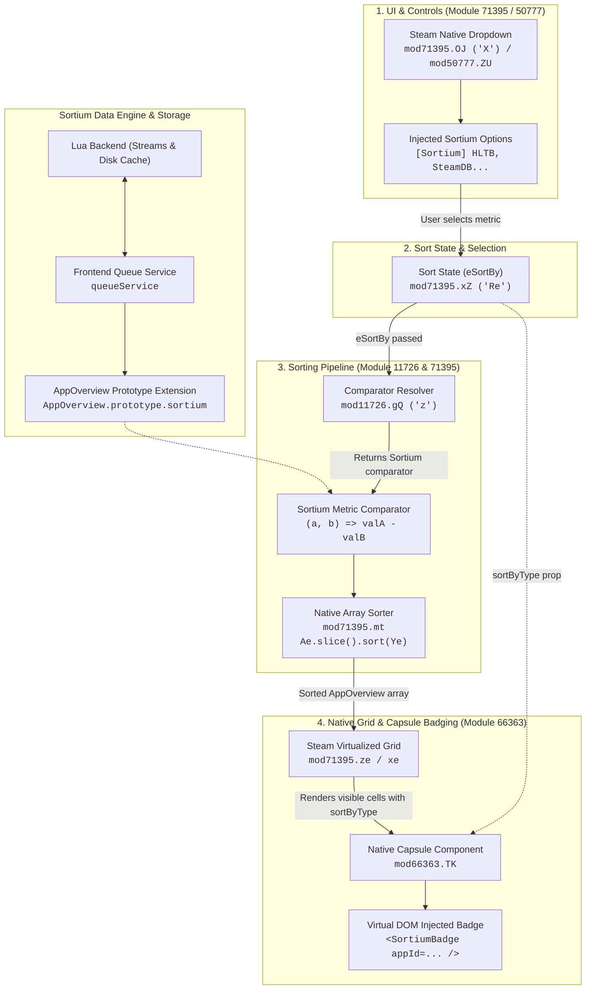
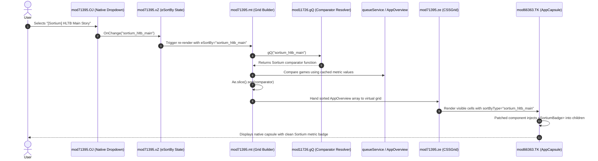

# Sortium Native Architecture (Empirically Verified)

This document outlines the reverse-engineered native Steam client architecture for **Sortium**, verified directly against the running Steam client runtime via the Chrome DevTools Protocol (`http://localhost:8080/json`).

---

## 1. High-Level Native Architecture



---

## 2. Sequence of a Sort Operation



---

## 3. The 4 Verified Verification Pillars

### Pillar 1: Dropdown Injection & Option Filtering
- **Target Modules**: Webpack Module `71395` (Export `OJ`, internal class `X`) and Module `50777` (Export `ZU`, internal class `_e`).
- **Internal Structure**:
  - `OJ` renders `(0, e.jsx)(S.ZU, { rgOptions: Mt, onChange: this.OnChange })`.
  - Default options (`ke()`) generate the 10 native sorting choices (Alphabetical, Friends, Achievements, Hours, Last Played, Release Date, Date Added, Size on Disk, Metacritic, Review).
- **Interception Mechanism**:
  - MobX binds an own property on `OJ` instances during construction (`{ writable: false, configurable: false }`).
  - To patch, hook `mod71395.OJ.prototype.render` using `React.cloneElement` on the returned dropdown element, or patch `mod50777.ZU.prototype.BuildMenu`.
  - Options can be filtered or appended; user clicks fire `OnChange(we)` directly with `we.data`.

### Pillar 2: Sorting Pipeline Hook
- **Target Modules**: Webpack Module `11726` (Export `gQ`), invoked inside Module `71395` function `mt()`.
- **Internal Structure**:
  - Inside `mt()`:
    ```javascript
    Ye = (0, Y.gQ)(Ne); // Y is Module 11726, Ne is eSortBy
    Ft = Ye ? Ae.slice().sort(Ye) : Ae; // Ae is Array<AppOverview>
    ```
  - Inside `mod11726.gQ`:
    ```javascript
    function z(S) {
        let b;
        switch(S) { case u: b = j; break; ... } // Maps sort ID to comparator
        return (m, T) => b && b(m, T) || i.tw.CompareSortAs(m, T);
    }
    ```
- **Interception Mechanism**:
  - Patch `mod11726.gQ`: when `eSortBy` matches a Sortium metric ID, return Sortium's comparator callback `(a, b) => valA - valB`.
  - Steam's native `Ae.slice().sort(Ye)` executes the sort on the raw overviews, feeding sorted order directly to the native virtualized grid.

### Pillar 3: Internal Metric Storage
- **Target**: `window.appStore.GetAppOverviewByAppID(appid)`.
- **Internal Structure**:
  - Every game overview instance inherits from `AppOverview.prototype`.
- **Extension Mechanism**:
  - Attach reactive getters to `AppOverview.prototype`:
    ```javascript
    Object.defineProperty(AppOverview.prototype, 'sortium_hltb', {
        get() { return queueService.getCachedData('hltb', this.appid); },
        configurable: true
    });
    ```
  - Data becomes accessible natively across all Steam components handling `app` or `overview`.

### Pillar 4: Virtual DOM Capsule Badging
- **Target Module**: Webpack Module `66363` (Export `TK`).
- **Internal Structure**:
  - Rendered inside Module `71395` (`xe`) as:
    ```javascript
    (0, e.jsx)(H.TK, {
        app: zt,                // rt wrapper around m_overview
        sortByType: we.eSortBy, // Active sort key passed as a direct prop!
        nWidth: St,
        ...
    })
    ```
- **Interception Mechanism**:
  - `H.TK` is wrapped in `React.memo`.
  - Using Millennium `wrapReactType` or `afterPatch` on `mod66363.TK`: when `sortByType` matches a Sortium metric, append `<SortiumBadge appId={app.appid} />` to `ret.props.children`.
  - Injection occurs at the Virtual DOM level, keeping badges perfectly in sync with Steam's virtualized row/column recycling without `MutationObserver` overhead or flicker.
