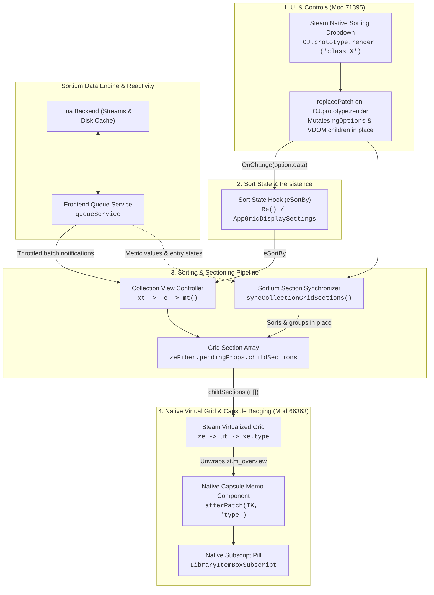
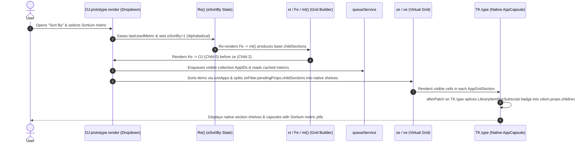

# Sortium Native Architecture (Empirically Verified)

This document outlines the reverse-engineered native Steam client architecture for **Sortium**, verified directly against the running Steam client runtime via the Chrome DevTools Protocol (`http://localhost:8080/json`).

> [!IMPORTANT]
> **Dynamic Module Resolution**: Numeric Webpack module IDs (`71395`, `11726`, `66363`, `50777`) and 2-letter minified export keys (`OJ`, `gQ`, `TK`, `ZU`) are build-specific artifacts shown here for reference. Production code **must** resolve modules once via `@steambrew/client` (`findModule`, `findModuleExport`) and cache the resolved references at module scope.

---

## 1. High-Level Native Architecture



---

## 2. Sequence of a Sort Operation



---

## 3. Webpack 5 & MobX Runtime Constraints

Before patching any Steam module, three runtime invariants must be respected:

1. **Webpack 5 ES Module Export Getters are Non-Configurable**:
   Webpack defines module exports via `t.d(exports, { key: () => fn })`, which sets `{ get: [Function], set: undefined, configurable: false }`. Plain exported functions (`gQ`, `IJ`, `xZ`) **cannot** be overwritten on the module export object (`afterPatch(mod, 'gQ')` throws `TypeError`).
   - **Mutable Seams**: Only **Class `.prototype` methods** (`OJ.prototype.render`, `OJ.prototype.shouldComponentUpdate`) and **`React.memo` / `forwardRef` `.type` properties** (`TK.type`, where `{ writable: true, configurable: true }`) can be patched directly via `@steambrew/client` (`afterPatch`, `beforePatch`, `replacePatch`).
2. **MobX `@observer` Lazily Locks Instance `render` Methods on First Render**:
   When a class component is decorated with MobX `@observer` (`(0, y.PA)(X)`), `X.prototype.render` is a lazy initializer that calls `Object.defineProperty(this, 'render', { configurable: false, writable: false, value: reactiveRender })` on first render.
   - **Implication**: Inside `replacePatch(OJ.prototype, 'render', ...)`, intercepting that initial `Object.defineProperty` call to store the reactive render function on `this._sortiumMobxRender` prevents `this.render` from being locked as an own property on the instance, keeping the prototype patch active across all subsequent renders.
3. **Production React VDOM Mutability**:
   Steam ships production React (`react-jsx-runtime.production.min.js`), where `Object.isFrozen(vdom.props)` and `Object.isFrozen(vdom.props.children)` are `false`. Mutating `dropdownEl.props` and `vdom.props.children` in place inside `replacePatch` / `afterPatch` avoids `React.cloneElement` allocations entirely.

---

## 4. The 4 Verified Integration Pillars

### Pillar 1: Dropdown Injection & Option Filtering
- **Reference Target**: Module `71395`, export `OJ` (internal class `X`).
- **Dynamic Lookup**: Cached once at module scope via `findModuleExport((e) => typeof e === 'function' && e.prototype?.OnChange && e.toString().includes('onSortChangeCallback'))`.
- **Internal Structure**:
  ```javascript
  class X extends a.Component {
      OnChange(we) {
          this.props.onSortChangeCallback(we.data);
          this.m_elDivRef.current && this.m_elDivRef.current.focus();
      }
      render() {
          const { rgOptions: Ee, initialValue: Ae, ... } = this.props;
          const Mt = Ee || ke(); // 10 native sort options
          return (0, e.jsxs)("div", {
              className: (0, s.A)(A().SortingDropDown, we),
              children: [
                  !wt && (0, e.jsx)("div", { className: A().SortingDropDownLabel, children: tt }),
                  (0, e.jsx)(S.ZU, { rgOptions: Mt, onChange: this.OnChange, selectedOption: Ae, ... })
              ]
          });
      }
  }
  ```
- **Interception Mechanism**:
  Patch `OJ.prototype.render` with `replacePatch` and mutate `dropdownEl.props` (`rgOptions`, `selectedOption`, `onChange`) and `vdom.props.children` in place to filter native options, append Sortium options, and render `<SortiumDirectionToggle />` and `<SortiumStreamStatus />` without `React.cloneElement`.

### Pillar 2: Direct `childSections` Sorting & Sectioning
- **Reference Target**: Module `71395` (`Fe`, `Ke`, `mt`, `ze`).
- **Internal Structure**:
  In `Fe`, Steam computes `st = mt({ appOverviews, eSortBy, ... })` and returns a `GridWithControls` container with two active children:
  1. Child 0: `<Ke sortBy={tt} onChange={Mt} />`, which renders `<X />` (`SortingDropDown`).
  2. Child 2: `<ze childSections={st} ...we eSortBy={tt} />`, which renders the virtualized `AppGridSection` shelves.
- **Interception & Reactivity Mechanism**:
  - Because React traverses fibers depth-first, Child 0 (`Ke` -> `X`) always renders **before** its sibling Child 2 (`ze`) in every render pass of `Fe`.
  - Patching `OJ.prototype.shouldComponentUpdate` with `replacePatch(..., () => true)` ensures `X` always renders whenever `Fe` renders (even when switching collections while `eSortBy` remains `1`).
  - During `X`'s render pass, `syncCollectionGridSections` walks up `this._reactInternals` (checking both `current` and `workInProgress` `.alternate` fibers) to locate `zeFiber` (`Ke.sibling`) and mutates `zeFiber.pendingProps.childSections` in place before `ze` renders:
    1. **Custom Sortium Metric Active**: Flattens all `rt` items across `childSections`, sorts them via `sortApps` (with `sort_as` alphabetical tie-breaking), and groups them into contiguous section objects using `formatMetricValue(..., 'section')` (`Over 100 Hours`, `Over 90%`, `No Data`, etc.).
    2. **Native Steam Sort Reversed**: Reverses `childSections` and each section's `children` array in place and updates `sectionIndex` when `settings.sortDirection` differs from the native sort's default direction.
  - This architecture requires zero `Array.prototype.sort` patching and zero `AppOverview.prototype` mutations.

### Pillar 3: Persistent Selection State
- **Target**: `PluginSettings.lastUsedMetric` and `PluginSettings.sortDirection` (`frontend/services/settings.ts` & `backend/settings.lua`).
- **Mechanism**:
  - `lastUsedMetric` is `""` when a native Steam sort option is active, or the metric ID (e.g., `"hltb_main"`) when a Sortium metric is active.
  - Persisting `lastUsedMetric` and `sortDirection` through `saveSettings` notifies all subscribed listeners immediately while keeping Steam's own `AppGridDisplaySettings` set to `1` (`Alphabetical`).

### Pillar 4: Native Virtual DOM Capsule Badging
- **Reference Target**: Module `66363`, export `TK` (`React.memo` wrapping MobX observer around internal function `sr`), and CSS class `LibraryItemBoxSubscript`.
- **Interception Mechanism**:
  - `mod66363.TK` is a `React.memo` object whose `.type` property is `{ writable: true, configurable: true }`, located once and cached at module scope.
  - Patching `TK` via `afterPatch(cachedCapsuleMemo, 'type', ...)` splices `<div className={cachedSubscriptClass}>{metricText}</div>` directly into `vdom.props.children` at index `1` when `settings.lastUsedMetric` is active and `props.context === 1` (`InCollection`).
  - Because `eSortBy` is `1` (`Alphabetical`) when a Sortium metric is active, Steam naturally suppresses native `Last Played` / `Hours Played` subscripts without prop spoofing.
